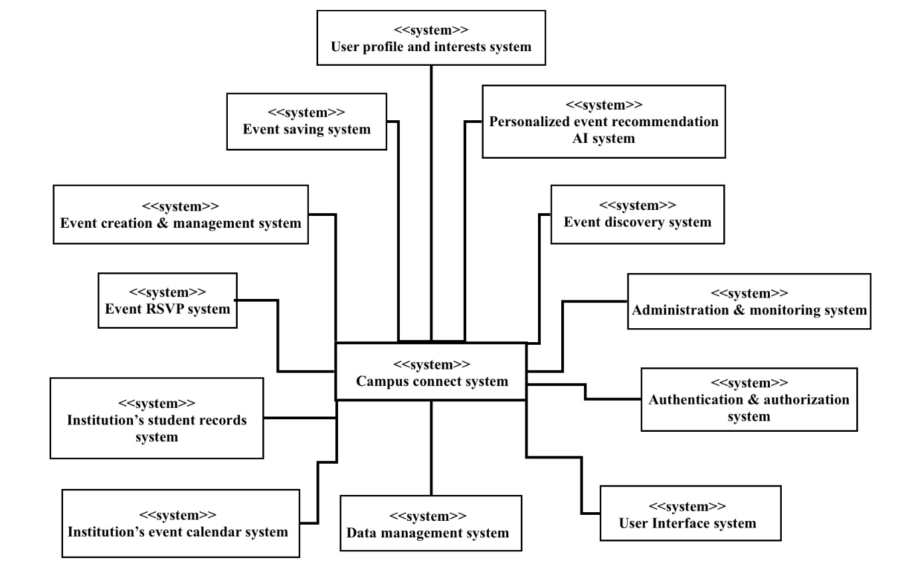

# LogicLab

The Campus Event Recommendation System is an AI-powered web application designed to help college and university students discover campus events that match their interests. Campus event information is often scattered across university websites, emails, student organizations, and social media, making relevant opportunities difficult to find.

The system centralizes campus events in one platform and provides personalized recommendations based on student interests and event information such as categories, tags, and descriptions. Students can also browse and search events, save events, and RSVP.

The primary users are students, while authorized student organizations, university departments, and event organizers can create and manage event listings. Colleges and universities are the primary target customers.

###### Core Features

- Student accounts and interest profiles
- Centralized campus event listings
- AI/ML-based personalized event recommendations
- Event search and filtering
- Saved events and RSVP functionality
- Event creation and management for authorized organizers


The initial version will be developed as a web application using a database for user and event information and an AI/ML recommendation component. Features such as ticket purchasing, financial transactions, room reservations, native mobile applications, and full integration with university systems are outside the initial project scope.

## System Context Daigram
 

## Team Member
- Brandon Jablasone (https://github.com/Bjablaso)
- Ankith Rajashekar (https://github.com/ankith860)
- Natalie Piltoyan (https://github.com/natpil)
- Nyeswaty Socree (https://github.com/nsocree)

## Backend Database Setup

The PostgreSQL schema for the UC-3 and UC-4 backend tables is in `backend/schema.sql`.
To create the tables in a fresh database and load the sample data, run:

```bash
psql "<PostgreSQL connection string>" -f backend/schema.sql
psql "<PostgreSQL connection string>" -f backend/seed.sql
```

The seed script creates sample student `1`, categories, interests, and events. It
skips existing categories, interests, events, and relationship rows so it can be
run again without duplicating those samples. Keep connection strings and passwords
out of source control.

## Deploying the Backend to Render

The root `render.yaml` configures a Python web service using `backend` as its root,
installs `backend/requirements.txt`, starts the FastAPI app with Uvicorn, and uses
`/health` for its health check. When creating the Render Blueprint, set the
`DATABASE_URL` environment variable in Render to the PostgreSQL connection string;
do not commit it to this repository.

After deployment, set `CORS_ORIGINS` in the Render service environment to the
frontend's origin (for example, `https://your-frontend.example.com`). Multiple
origins can be separated by commas. The backend defaults to the local development
origins `http://localhost:5173` and `http://localhost:8081`.

The deployed API base URL can then be used by the frontend instead of
`http://127.0.0.1:8000`. Check `/health` and `/docs` on the deployed service after
the first deploy.
